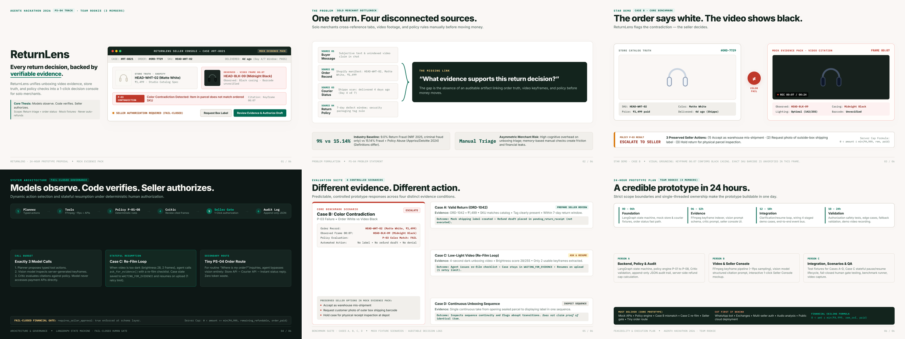

# ReturnLens 🔍
### Autonomous Evidence-Backed Return Triage Agent for Solo D2C Merchants
**AgentX Hackathon 2026 · Track PS-04 (Autonomous Support Agent)**  
**Team Rookie (3 Members) · 24-Hour Prototype Feasibility**

---



## 📌 Project Overview & Current Stage

> **Submission Scope:** **Idea Round Prototype Proposal**  
> This repository contains the official pitch deck, canonical content specification, generation engine, staged benchmark evidence, and verified build pipeline. It defines the architecture, deterministic policy rules, and 24-hour execution roadmap for the hackathon prototype. It is not an existing live commercial deployment.

**ReturnLens** is an evidence-backed returns triage agent tailored for solo direct-to-consumer (D2C) online sellers who manage customer support, orders, and returns alone.

When an online customer submits a return request with a short unboxing video (30–60 seconds), ReturnLens:
1. **Intake**: Extracts video keyframes at ~1 fps via FFmpeg alongside customer reason and order ID.
2. **Plan**: Formulates a typed JSON plan schema (`requires_seller_approval: true`).
3. **Evidence**: Pulls store truth (Shopify mock API) and courier tracking scans (Shippo mock API), indexing visual observations against timestamped frames (e.g. Frame 00:07).
4. **Verify**: Runs deterministic code policies (`P-01` to `P-08`) and invokes an independent critic loop to verify cited frames and flag unsupported observations.
5. **Decide & Authorize**: Enforces a strict fail-closed decision function, presenting structured evidence to the merchant console for **one-click human seller authorization**.

> **Core Philosophy:** *Models observe. Code verifies. Seller authorizes.*  
> No automatic customer denials. No mock refund or return label is ever released without explicit merchant approval.

---

## 🎯 Track PS-04 Alignment (Primary & Secondary Routes)

While ReturnLens differentiates itself through **multimodal, video-backed return triage** (solving the solo seller's most expensive problem), it also covers routine customer support inquiries under Problem Statement PS-04:
- **Primary Video Triage Route:** Analyzes customer unboxing footage, checks policies P-01–P-08, extracts timestamp citations, and prepares human-in-the-loop authorization.
- **Secondary Order Status Route (Zero-Vision Fast Path):** When a buyer asks *"Where is my order?"*, the agent directly reuses the mock Shopify and Shippo APIs to return real-time delivery timestamps and courier status scans, escalating to the seller only if courier delay thresholds are exceeded.

---

## 🧠 Technical Defensibility & Judge Q&A Defense

| Question / Concern | Technical Mechanism in ReturnLens | Architecture Guarantee |
| :--- | :--- | :--- |
| **Q1: Why is this an agent rather than a hardcoded workflow?** | **Dynamic state machine with conditional branching & pause/resume.**<br>In Case C, upon detecting low-light video (brightness 28), the agent dynamically halts normal execution, calls `ask_for_evidence()` with specific re-filming guidance, transitions the state machine to `WAITING_FOR_EVIDENCE`, pauses execution, and resumes the exact ticket context when new evidence arrives (1 retry limit). Conversely, routine order queries take a zero-vision fast path directly querying mock store and courier APIs. | **Stateful resumption & adaptive tool selection** rather than static linear scripting. |
| **Q2: What happens if vision or critic models hallucinate?** | **Observations are non-binding; code enforces business truth.**<br>Vision model outputs (`observed_color`, `damage_flag`) are treated strictly as observation metadata. Hard constraints (7-day delivery window from courier scans, SKU comparisons) are verified in deterministic Python (`P-01` to `P-08`). The critic provides an adversarial sanity check against cited timestamps. If both models suffer correlated errors, the **fail-closed human gate** ensures no refund or label is ever issued without seller review. | **Zero autonomous execution.** LLMs propose; deterministic code verifies; human authorizes. |
| **Q3: How do you prevent duplicate or incorrect refunds?** | **Code-level financial guardrails & idempotency keys.**<br>1. Idempotency keys (`hash(order_id, return_id, transaction_type)`) block duplicate execution at the mock API layer.<br>2. Ledgers enforce: $\text{amount} \le \min(₹4,999, \text{remaining refundable amount}, \text{order paid amount})$.<br>3. LLMs possess **zero access** to financial release tools; refunds are created in draft state `pending_return_receipt` awaiting merchant cryptographic/UI authorization. | **Mathematical refund ceiling** and backend-enforced transaction idempotency. |

---

## 📦 Verified Deliverables & Repository Map

All deliverables are generated from source code and maintained in both the repository root and `deliverables/`:

| Deliverable | File Path | Verified Specifications |
| :--- | :--- | :--- |
| **Flagship HTML Deck (v5)** | [`ReturnLens_v5.html`](ReturnLens_v5.html) / [`index.html`](index.html) | Standalone editorial redesign (1280×720) with pure CSS/SVG visuals, hero console, keyboard navigation, Grid Overview (`O`), and Speaker Notes (`N`). |
| **Flagship PDF (v5)** | [`ReturnLens_v5.pdf`](ReturnLens_v5.pdf) / [`deliverables/ReturnLens_v5.pdf`](deliverables/ReturnLens_v5.pdf) | Exactly 6-page vector PDF (16:9, 960×540 pt) rendered via headless browser with zero box clipping. |
| **Flagship Preview Sheet (v5)**| [`ReturnLens_v5_preview.png`](ReturnLens_v5_preview.png) | High-resolution 2352×882 master 6-slide contact sheet preview (3×2 grid). |
| **Canonical Content Spec** | [`content/deck_data.json`](content/deck_data.json) | Single source of truth containing verified copy, metrics, policy rules, and technical speaker notes consumed by both HTML and PPTX generators. |
| **PowerPoint Deck (v4)** | [`ReturnLens_v4.pptx`](ReturnLens_v4.pptx) | Native, editable 16:9 presentation with embedded high-resolution photos, vector shapes, and **verified speaker notes on all 6 slides** (~1.2 MB package). |
| **Baseline Deck (v4)** | [`ReturnLens_v4.pdf`](ReturnLens_v4.pdf) / [`ReturnLens_v4.html`](ReturnLens_v4.html) | Canonical v4 deliverables retained for regression testing and comparative audits. |
| **HTML & PDF Generator** | [`src/generate_v4_html.py`](src/generate_v4_html.py) | Python master build script consuming `deck_data.json`, with cross-platform browser discovery (Chrome/Edge) and 100% idempotent execution. |
| **PowerPoint Generator** | [`src/build_v4_pptx.py`](src/build_v4_pptx.py) | Python script generating native PPTX via `python-pptx` with embedded product imagery and technical speaker notes. |
| **Extended Smoke Tests** | [`scripts/smoke_test.py`](scripts/smoke_test.py) | Automated test suite validating deliverable synchronization, PDF page counts, PPTX embedded media integrity, speaker notes, preview dimensions, and generator idempotency. |

```text
hack4hack/
├── content/                          # Single Source of Truth
│   └── deck_data.json                # Canonical presentation content, prices, and notes
│
├── deliverables/                     # Official submission artifacts
│   ├── ReturnLens_v5.pptx            # Flagship native editable PowerPoint deck (16:9) with notes
│   ├── ReturnLens_v5.pdf             # Flagship 6-page vector PDF (16:9, 960x540 pt)
│   ├── ReturnLens_v5.html            # Flagship standalone interactive HTML deck
│   ├── ReturnLens_v5_preview.png     # Flagship 6-slide preview contact-sheet (2352x882)
│   ├── ReturnLens_v4.pptx            # Baseline v4 native editable PowerPoint deck
│   ├── ReturnLens_v4.pdf             # Baseline v4 6-page PDF
│   ├── ReturnLens_v4.html            # Baseline v4 standalone interactive HTML deck
│   └── ReturnLens_v4_preview.png     # Baseline v4 preview contact-sheet (2352x900)
│
├── src/                              # Source code, generators, and assets
│   ├── build_v5_pptx.py              # Flagship Python script generating native v5 PPTX
│   ├── generate_v5_html.py           # Flagship Python script compiling v5 HTML, PDF & preview
│   ├── build_v4_pptx.py              # Baseline Python script generating v4 PPTX
│   ├── generate_v4_html.py           # Baseline Python script compiling v4 HTML & PDF
│   └── assets/                       # Staged photos, video frames, and slide renders
│       ├── studio_white_headphones.jpg   # Store catalog ground truth photo (HEAD-WHT-02, Matte White)
│       ├── unboxing_black_headphones.jpg # Customer video unboxing frame at 00:07 (Midnight Black)
│       └── slides/                       # High-resolution rendered PNG images
│
├── scripts/                          # Automated testing and verification
│   └── smoke_test.py                 # Extended QA suite validating v5 & v4 build, media & sync
│
├── research/                         # Background research & problem statement analysis
│   └── AgentX_Idea_Research.html     # Deep dive on 7 AgentX problem statements & market friction
│
├── archive/                          # Historical iterations (v0, v1 Swiss, v2, v3)
├── requirements.txt                  # Python build dependencies
├── ReturnLens_v5.html                # Flagship root deliverable (matches deliverables/)
├── ReturnLens_v5.pdf                 # Flagship root deliverable (matches deliverables/)
├── ReturnLens_v5.pptx                # Flagship root deliverable (matches deliverables/)
├── ReturnLens_v5_preview.png         # Flagship root deliverable (matches deliverables/)
├── index.html                        # GitHub Pages entry point (Flagship v5)
└── README.md                         # Project documentation and review guide
```

---

## 🎯 6-Slide Pitch Deck Architecture

### Slide 1: Product Launch & Executive Summary
- **Tag**: `AgentX Hackathon 2026 · Track PS-04`
- **Headline**: `RETURNLENS` — *“Every return decision, backed by evidence.”*
- **Value Proposition**: Evidence-backed returns triage agent for solo direct-to-consumer online sellers.
- **Scope Guardrails**: Return triage core + 1 zero-vision order-status route. Fail-closed architecture; no autonomous refunds.
- **Visual Anchor**: Seller Review Console mockup featuring Case RT-8821 / ORD-7729 with store truth (`HEAD-WHT-02`, ₹1,499), unboxing keyframe 00:07 citation, honest visual observation (*“Observed item casing is Midnight Black. Exact barcode unverified.”*), policy verification (`P-03 Manifest Match: CONTRADICTION FLAGGED`, `P-04 Return Window: PASS`), status `STATUS: ESCALATED FOR SELLER DECISION`, and 1-click review authorization.

### Slide 2: The Problem as a Visual Story (3-Column Zero-Overlap Layout)
- **Tag**: `The Problem · Solo Seller Bottleneck`
- **Headline**: `One return. Four disconnected sources.`
- **Subtitle**: *Four systems. No traceable decision. Without a shared record, the seller connects order facts, video, and policy manually from memory.*
- **Visual Layout**: 3-column composition without overlap:
  - *Left Column*: Source 01 (Buyer Video & Claim) & Source 03 (Courier Tracking Scan: Delivered 4 days ago, Shippo mock API).
  - *Center Pillar (Critical Gap)*: **`NO SHARED EVIDENCE RECORD`** — *Today the seller opens 4 browser tabs and guesses. An erroneous refund burns inventory margin; an unfair denial destroys repeat customer trust. The gap is the absence of an auditable artifact tying order truth, video keyframes, and policy clauses together before money moves.*
  - *Right Column*: Source 02 (Store Order Truth: White Headphones, ₹1,499, Shopify mock API) & Source 04 (Store Return Policy: 7-day window, sealed tag, code rules P-01 to P-08).
- **Sourced Signal**: Fraud estimates differ by definition: **9%** (*NRF 2025, fraud only*) vs **15.14%** (*Appriss/Deloitte 2024, fraud + abuse*).

### Slide 3: The Star Demo (Visual Evidence Benchmark)
- **Tag**: `Visual Evidence Benchmark · Core Demonstration`
- **Headline**: `The order says white. The video shows black.`
- **Subtitle**: *ReturnLens flags the contradiction — the seller decides.*
- **Visual Contrast**:
  - *Left Card (Order Ground Truth)*: High-resolution catalog photo of `HEAD-WHT-02` (Matte White, ₹1,499, delivered 4 days ago).
  - *Right Card (Video Keyframe)*: Customer unboxing frame at `00:07` showing Midnight Black item. Grounded citation explicitly notes: *“Observed Color: Midnight Black · Exact SKU: Not verified · Tag: Not visible in cited frame”*.
- **Deterministic Policy Gate**:
  - Rule `P-03: COLOR CONTRADICTION`.
  - Plan Schema: `typed JSON, requires_seller_approval: true`.
  - Status: `STATUS: ESCALATE (SELLER REVIEW REQUIRED)` — Color contradiction observed; exact SKU unverified; automated return label and refund payout inhibited.
  - **3 Seller Options**:
    1. Request unboxing video with packaging label / serial number visible.
    2. Reject return under policy (item does not match order record).
    3. Override & approve if seller acknowledges known warehouse fulfillment error.
  - **Financial Cap**: $0 < \text{amount} \le \min(₹4,999, \text{remaining refundable amount}, \text{order paid amount})$.

### Slide 4: System Architecture (Dynamic Agentic Governance)
- **Tag**: `System Architecture · Dynamic Agentic Governance`
- **Headline**: `Models observe. Code verifies. Seller authorizes.`
- **Subtitle**: *Dynamic action selection and stateful resumption under deterministic human authorization.*
- **6-Step Pipeline**:
  $$\text{01 PLAN [MODEL]} \longrightarrow \text{02 RETRIEVE [CODE]} \longrightarrow \text{03 EVALUATE [CODE]} \longrightarrow \text{04 AUDIT [MODEL]} \longrightarrow \text{05 AUTHORIZE [HUMAN]} \longrightarrow \text{06 RECORD [CODE]}$$
- **Dual Operational Branches**:
  - *Dynamic Stateful Clarification Loop (Case C)*: $\text{Dark Frames} \longrightarrow \text{ask\_for\_evidence()} \longrightarrow \text{WAITING\_FOR\_EVIDENCE} \longrightarrow \text{Customer Uploads} \longrightarrow \text{Resume Case}$
  - *Secondary PS-04 Order Status Fast Path*: $\text{Query: “Where is my order?”} \longrightarrow \text{Direct Mock Store \& Shippo API} \longrightarrow \text{Delivery Scan \& Timestamp}$
- **Core Architecture Guarantees**:
  - *Model Calls*: Bounded design estimate (3 base calls: planner, vision, critic + retries).
  - *Policy Rules*: Deterministic Python code rules `P-01` to `P-08`, never prompts.
  - *Critic Duty*: Reviews cited frames and flags unsupported observations (correlated error limits noted).
  - *Safety Boundary*: Backend authorization boundary — LLMs cannot execute financial refund tools.

### Slide 5: Four Demo Benchmark Scenarios
- **Tag**: `Demo Scenarios · Controlled Prototype Behaviors`
- **Headline**: `Four evidence conditions. Four controlled actions.`
- **Subtitle**: *Expected prototype behaviors across staged benchmark cases. Not measured production metrics.*
- **4 Reproducible Benchmark Cases**:
  - **Case 01 · Consistent (Clear Defect - ORD-1042, ₹1,499)**:
    - *Evidence*: Staged casing crack verified in unboxing frame 00:04 · Manifest & return window match.
    - *Expected Action*: **PREPARE SELLER REVIEW** — Agent prepares mock shipping label & drafts refund in `pending_return_receipt`. Money releases only upon warehouse receipt.
  - **Case 02 · Contradiction (Color Mismatch - Core Benchmark)**:
    - *Evidence*: White ordered (`HEAD-WHT-02`) vs Black unboxed in Frame 00:07 · Exact SKU unverified.
    - *Expected Action*: **ESCALATE TO SELLER** — Policy `P-03` blocks automation. Inhibits label and refund. Seller selects 1 of 3 concrete resolution options.
  - **Case 03 · Unclear (Low Lighting - Agentic Clarification Loop)**:
    - *Evidence*: 4-second dark video, brightness 28/255, barcode obscured · Insufficient visual evidence.
    - *Expected Action*: **ASK AND RESUME** — Agent calls `ask_for_evidence()`; transitions ticket to `WAITING_FOR_EVIDENCE`; resumes context on upload (1 retry limit).
  - **Case 04 · Sequence (Continuity Check)**:
    - *Evidence*: Staged continuous take from sealed parcel opening to product reveal · Sequence inspected.
    - *Expected Action*: **INSPECT CONTINUITY** — *Expected prototype behavior: inspect sequence continuity and flag missing transitions for seller review.*

### Slide 6: 24-Hour Execution & Feasibility
- **Tag**: `24-Hour Prototype Plan · Feasibility & Scope Guardrails`
- **Headline**: `A credible prototype in 24 hours.`
- **Subtitle**: *Strict scope boundaries and single-threaded ownership make the prototype fully buildable in one day.*
- **24-Hour Timeline Grid**:
  - `00h – 06h · Foundation`: **Mock APIs & Agent State** · LangGraph orchestrator, mock store/courier fixtures, order status fast path · *Owner: Person A (Agent / Backend / Policy)*
  - `06h – 12h · Evidence`: **Evidence Pipeline & UI** · FFmpeg keyframe indexer, vision prompt schema, critic prompt, seller console UI · *Owner: Person B (Vision / Evidence / UI)*
  - `12h – 18h · Integration`: **State Flow & Scenarios** · Clarification/resume loop, wiring 4 staged demo cases, end-to-end event bus · *Owner: Person C (Fixtures / Integration / QA)*
  - `18h – 24h · Validation`: **Testing & Submission** · Fallback testing, authorization safety tests, demo video recording, README · *All 3 Members*
- **Scope Discipline**:
  - **Must Deliver (Core Prototype)**: Mock store & courier APIs, deterministic policy engine (`P-01` to `P-08`), frame citations, fail-closed seller authorization gate, structured JSON audit log, stateful clarification/resume loop, 4 reproducible demo scenarios.
  - **Cut First If Behind (Deferred Expansion)**: Advanced continuity checks (Case D stretch), live external carrier/store integrations, video OCR barcode scanner, live payment gateways, merchant analytics dashboard.

---

## 🛠️ How to Reproduce & Verify All Deliverables

### Prerequisites
- Python 3.10+
- An installed headless browser (Microsoft Edge or Google Chrome)

### 1. Install Dependencies
```bash
pip install -r requirements.txt
```

### 2. Run the Extended Smoke & QA Test Suite
```bash
python scripts/smoke_test.py
```
This script will:
- Validate `content/deck_data.json` single source of truth.
- Run `src/generate_v5_html.py` to compile HTML, invoke Edge/Chrome headless PDF rendering, and export contact sheet preview.
- Verify that `generate_v5_html.py` does not modify its own source code (idempotency check).
- Run `src/build_v5_pptx.py` to generate the flagship native PowerPoint presentation.
- Verify byte synchronization across root and `deliverables/` (HTML, PDF, PPTX, Preview PNG).
- Validate that the flagship PDF has exactly 6 pages in true 16:9 widescreen ($960 \times 540\text{ pt}$).
- Validate that all 6 slides in the PPTX contain verified embedded technical speaker notes.
- Check that preview dimensions are exactly 2352×882 (true 16:9 for 3×2 grid).
- Check that all evidence grounding rules are satisfied (honest unverified barcode citation, secondary PS-04 route, Case C stateful loop, conservative Case D sequence, zero exchange contradiction).
- **Run automated visual QA (Test 9)**: Validate shape boundary safety, absence of footer collisions, positive clear separation between titles, nodes, and metadata.

### 3. Rebuild Individual Outputs
- To rebuild flagship v5 HTML, PDF, and slide contact sheet preview:
  ```bash
  python src/generate_v5_html.py
  ```
- To rebuild flagship v5 native PowerPoint presentation:
  ```bash
  python src/build_v5_pptx.py
  ```
- To rebuild baseline v4 deliverables:
  ```bash
  python src/generate_v4_html.py
  python src/build_v4_pptx.py
  ```

---

## 🛡️ Technical & Ethical Guardrails

1. **Fail-Closed Architecture**: The model is purely observational. All state transitions, policy checks, and refund drafts run through deterministic Python code.
2. **Cap on Draft Refunds**: Hard ceiling enforced at code level: $\min(₹4,999, \text{remaining balance}, \text{order amount})$.
3. **Audit Trail**: Every evaluation outputs an immutable structured JSON log recording frame citations, rule evaluations, and timestamps.
4. **No Real PII / Mock Data**: All customer identities, shipping tracking scans, and store orders are staged mock fixtures for hackathon evaluation.
