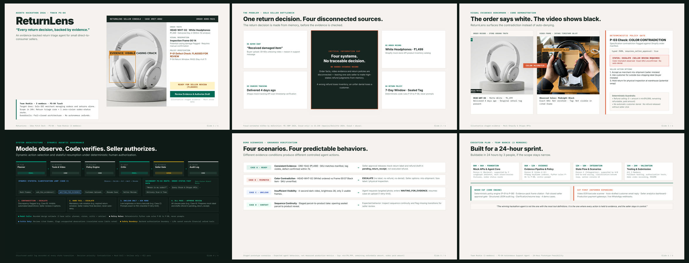

# ReturnLens 🔍
### Autonomous Evidence-Backed Return Triage Agent for Solo D2C Merchants
**AgentX Hackathon 2026 · Track PS-04 (Autonomous Support Agent)**  
**Team Rookie (3 Members) · 24-Hour Prototype Feasibility**

---



## 📌 Executive Summary

**ReturnLens** is an evidence-backed returns triage agent tailored for solo direct-to-consumer (D2C) online sellers who manage orders and returns alone.

When a customer submits a return request with a short unboxing video (30–60 seconds), ReturnLens:
1. **Intake**: Extracts video keyframes at ~1 fps via FFmpeg alongside buyer reason and order ID.
2. **Plan**: Formulates a typed JSON plan schema (`requires_seller_approval: true`).
3. **Evidence**: Pulls store truth (Shopify mock API) and courier scans (Shippo mock API), indexing visual observations against timestamped frames (e.g. Frame 00:07).
4. **Verify**: Runs deterministic code policies (`P-01` to `P-08`) and invokes an independent critic loop to verify cited frames and flag unsupported observations.
5. **Decide & Authorize**: Enforces a strict fail-closed decision function, presenting structured evidence to the merchant console for **one-click human seller authorization**.

> **Core Philosophy:** *Models observe. Code verifies. Seller authorizes.*  
> No automatic customer denials. No mock refund or return label is ever released without explicit merchant approval.

---

## 📦 Deliverables & Repository Map

| Deliverable | File Path | Description |
| :--- | :--- | :--- |
| **Interactive HTML Deck** | [`ReturnLens_v4.html`](ReturnLens_v4.html) / [`index.html`](index.html) | Standalone, self-contained 16:9 widescreen presentation (1280×720) with embedded base64 photorealistic assets and keyboard navigation. |
| **Submission PDF** | [`ReturnLens_v4.pdf`](ReturnLens_v4.pdf) | Exactly 6-page 16:9 widescreen PDF rendered via headless Edge with vector typography and zero clipping. |
| **PowerPoint Deck** | [`ReturnLens_v4.pptx`](ReturnLens_v4.pptx) | Native, editable 16:9 presentation with embedded high-resolution photos, vector shapes, and comprehensive speaker notes. |
| **Master Preview** | [`ReturnLens_v4_preview.png`](ReturnLens_v4_preview.png) | High-resolution 2304×1008 master 6-slide contact sheet preview. |
| **HTML & PDF Generator** | [`src/generate_v4_html.py`](src/generate_v4_html.py) | Python master build script compiling HTML, invoking Edge headless PDF rendering, and generating preview sheets. |
| **PowerPoint Generator** | [`src/build_v4_pptx.py`](src/build_v4_pptx.py) | Python script generating native PPTX via `python-pptx` with pixel-matched layout and typography. |

```text
hack4hack/
├── deliverables/                     # Official v4 submission artifacts
│   ├── ReturnLens_v4.pptx            # Native editable PowerPoint deck (16:9)
│   ├── ReturnLens_v4.pdf             # 6-page presentation PDF
│   ├── ReturnLens_v4.html            # Standalone interactive HTML deck
│   └── ReturnLens_v4_preview.png     # Full 6-slide preview contact-sheet
│
├── src/                              # Source code, generators, and assets
│   ├── build_v4_pptx.py              # Python script generating native PPTX
│   ├── generate_v4_html.py           # Python script compiling HTML, PDF & preview
│   └── assets/                       # Staged photos, video frames, and slide renders
│       ├── demo_white_order.jpg      # Store catalog ground truth photo (HEAD-WHT-02, Matte White)
│       ├── demo_black_frame.jpg      # Customer video unboxing frame at 00:07 (HEAD-BLK-09, Midnight Black)
│       ├── hero_video_frame.jpg      # Defect inspection frame at 00:14 with seam crack
│       └── slides/                   # Rendered PNG images of slides 1 to 6
│
├── research/                         # Background research & problem statement analysis
│   └── AgentX_Idea_Research.html     # Deep dive on 7 AgentX problem statements & market friction
│
├── archive/                          # Historical iterations (v0, v1 Swiss, v2, v3)
├── ReturnLens_v4.html                # Root deliverable (matches deliverables/)
├── ReturnLens_v4.pdf                 # Root deliverable (matches deliverables/)
├── ReturnLens_v4.pptx                # Root deliverable (matches deliverables/)
├── ReturnLens_v4_preview.png         # Root deliverable (matches deliverables/)
├── index.html                        # GitHub Pages entry point
└── README.md                         # Project documentation and review guide
```

---

## 🎯 6-Slide Pitch Deck Architecture

### Slide 1: Product Launch & Executive Summary
- **Tag**: `AgentX Hackathon 2026 · Track PS-04`
- **Headline**: `RETURNLENS` — *“Review returns with cited video evidence.”*
- **Value Proposition**: Evidence-checked returns triage agent for solo direct-to-consumer online sellers.
- **Scope Guardrails**: Return triage only, mock store data + 1 order-status route. Not another chatbot; not an autonomous refund gate.
- **Visual Anchor**: Seller Review Console mockup featuring Case RET-4082 / ORD-9021 with inspection frame 00:14, store truth (`HEAD-WHT-02`, ₹1,499), policy verification (`P-01 PASS`, `P-04 PASS`), status `READY FOR SELLER REVIEW`, and one-click draft authorization.

### Slide 2: The Problem as a Visual Story
- **Tag**: `The Problem · Solo Seller Bottleneck`
- **Headline**: `One return decision. Four disconnected sources.`
- **Subtitle**: *The return decision is made from memory, before the evidence is checked.*
- **Visual Layout**: 4 disconnected source cards converging on a central gap box:
  1. *01 Buyer Chat*: “Received damaged item” (unverified claim, 30–60s video upload).
  2. *02 Order Record*: White Headphones, ₹1,499 (Shopify mock database).
  3. *03 Courier Tracking*: Delivered 4 days ago (Shippo mock tracking API).
  4. *04 Return Policy*: 7-day window, sealed tag (code rules P-01 to P-08).
- **Critical Information Gap**: *No single record ties order, video frame, policy clause, and decision together.* Today the seller opens many tabs, then decides alone. A wrong refund loses money and stock; an unfair denial loses a repeat customer.
- **Sourced Signal**: Fraud estimates differ by definition: **9%** (*NRF 2025, fraud only*) vs **15.14%** (*Appriss/Deloitte 2024, fraud + abuse*).

### Slide 3: The Star Demo (Visual Evidence Benchmark)
- **Tag**: `Visual Evidence Benchmark · Core Demonstration`
- **Headline**: `The order says white. The video shows black.`
- **Subtitle**: *ReturnLens surfaces the contradiction instead of auto-denying.*
- **Visual Contrast**:
  - *Left Card (Order Ground Truth)*: Studio photo of `HEAD-WHT-02` (Matte White, ₹1,499, delivered 4 days ago, tag present).
  - *Center Badge*: `COLOR MISMATCH`.
  - *Right Card (Video Keyframe)*: Customer unboxing frame at `00:07` showing `HEAD-BLK-09` (Midnight Black).
- **Deterministic Policy Gate**:
  - Rule `P-03 SKU Mismatch: FAIL`.
  - Plan Schema: `typed JSON, requires_seller_approval: true`.
  - Status: `ESCALATE (NEEDS SELLER REVIEW)` — model proposes, human authorizes; no label or refund auto-issued.
  - **3 Seller Options**:
    1. Accept as merchant mis-shipment (seller mistake).
    2. Ask customer for outside-box shipping label (buyer mistake).
    3. Hold return for physical inspection at warehouse (potential swap).
  - **Financial Cap**: $0 < \text{amount} \le \min(₹4,999, \text{remaining refundable amount}, \text{order paid amount})$.

### Slide 4: System Architecture (Deterministic Pipeline)
- **Tag**: `System Architecture · Deterministic Pipeline`
- **Headline**: `Models observe. Code verifies. Seller authorizes.`
- **Subtitle**: *Policy checks and seller approval control actions.*
- **6-Step Pipeline**:
  $$\text{Planner [MODEL]} \longrightarrow \text{Tools [CODE]} \longrightarrow \text{Policy Engine [CODE]} \longrightarrow \text{Critic [MODEL]} \longrightarrow \text{Seller Gate [HUMAN]} \longrightarrow \text{Audit Log [CODE]}$$
- **4 Decision Function Outcomes (Strict Priority Order)**:
  1. `Contradiction → Escalate`: Discrepancy flagged (e.g. Case B); inhibits automated label and refund draft.
  2. `Hard Fail → Escalate`: Mandatory rule violation (e.g. expired return window); seller decides; never auto-deny.
  3. `Unclear Only → Ask More`: Low brightness or blurry barcode (e.g. Case C); exact re-film checklist (1 retry limit).
  4. `All Pass → Approve for Seller Review`: All clauses pass (e.g. Case A); prepares mock label and drafts refund in `pending_return_receipt`.
- **Core Architecture Rules**:
  - *Model Calls*: Exactly 3 base LLM calls per case (planner, vision, critic) plus retries.
  - *Policy Clauses*: Deterministic Python code rules `P-01` to `P-08`, never prompts.
  - *Critic Duty*: The critic reviews cited frames and flags unsupported observations.
  - *Server Frames*: Server-generated with `frame_id`, timestamp, video hash, and frame hash. Model may only cite frames given.
  - *Safety Boundary*: Prompt injection cannot modify policy code, exceed server caps, or bypass human gate.

### Slide 5: Four Demo Benchmark Scenarios
- **Tag**: `Demo Scenarios · Grounded Verification`
- **Headline**: `Four scenarios. Four predictable behaviors.`
- **Subtitle**: *Every decision can be clicked back to a frame, a clause, and a log entry.*
- **4 Reproducible Benchmark Cases**:
  - **Case A · Clean Return (`ORD-1042`, ₹1,499)**:
    - *Evidence*: SKU matches manifest, tag present, visible casing crack within 7-day window.
    - *Action*: Seller approval releases mock return label and refund draft in `pending_return_receipt`, not executed refund.
  - **Case B · Color Contradiction (Core Benchmark)**:
    - *Evidence*: Ordered `HEAD-WHT-02` vs Video Frame 00:07 `HEAD-BLK-09`. Policy `P-03 SKU mismatch FAIL`.
    - *Action*: `ESCALATE` (no label, no refund, no denial). Seller chooses mis-shipment / box label / physical inspection.
  - **Case C · Poor Lighting (Unclear Evidence)**:
    - *Evidence*: 4-second dark video, brightness 28, only 2 usable frames.
    - *Action*: `ASK MORE EVIDENCE` (case stays open with exact re-film checklist; 1 retry limit).
  - **Case D · Unbroken Video Take (Continuity)**:
    - *Evidence*: One continuous take from opening sealed parcel to showing the label in one continuous sequence.
    - *Action*: Continuity verified; prevents photo-swap fraud before mock return label generation. Proves why video beats static photos.

### Slide 6: 24-Hour Execution & Feasibility
- **Tag**: `Execution Plan · Team Rookie (3 Members)`
- **Headline**: `Built for a 24-hour sprint.`
- **Subtitle**: *Buildable in 24 hours by 3 people, if the scope stays narrow.*
- **Team Ownership (3 Members)**:
  - **Person A (Backend & Agent Core)**: Agent graph, deterministic policy engine, evidence critic, structured audit log.
  - **Person B (Video Pipeline & UI)**: FFmpeg keyframe indexer, seller review console, evidence pack visualizer.
  - **Person C (Integration & Verification)**: Mock Shopify/Shippo APIs, 4 demo cases (A–D), fallback testing, demo video, README.
- **Scope Discipline**:
  - **Never Cut (Core Engine)**: Deterministic policy engine (`P-01` to `P-08`), evidence-pack frame citation, fail-closed seller approval gate, structured JSON audit log, 4 reproducible demo cases.
  - **Cut First (Deferred Expansion)**: Video OCR barcode scanner, auto-drafted customer email reply, seller analytics dashboard, production payment gateways / live WhatsApp webhooks.
- **Closing Motto**:
  > *“The winning hackathon agent is not the one with the most tool definitions. It is the one where every action is held to evidence, and the seller stays in control.”*

---

## 🛡️ Technical & Ethical Guardrails

1. **Fail-Closed Architecture**: The model is purely observational. All state mutations and financial triggers run through deterministic code.
2. **Cap on Draft Refunds**: Hard ceiling enforced at code level: $\min(₹4,999, \text{remaining balance}, \text{order amount})$.
3. **Audit Trail**: Every evaluation outputs a structured JSON log recording frame citations, rule evaluations, and timestamps.
4. **No Real PII / Mock Data**: All customer identities, shipping tracking scans, and store orders are staged mock fixtures for hackathon evaluation.
