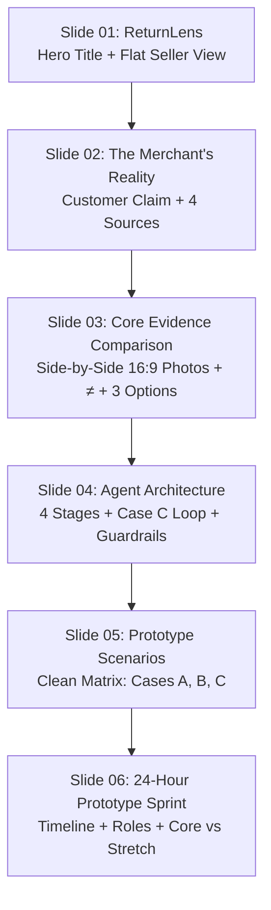

# RETURNLENS V9 — MINIMALIST ART DIRECTION & TYPOGRAPHY QA REPORT
**Role:** Principal Product Designer, Senior Software Architect, AI Safety Auditor, and Hackathon Technical Reviewer  
**Competition:** AgentX Hackathon 2026 — Track PS-04 (Autonomous Support Agent for Solo D2C Merchants)  
**Target Round:** **Idea Round (Vòng Ý Tưởng) — Judging Submission Edition (v9)**  
**Deliverable Set:** Exactly 6 slides (16:9 widescreen, 13.333×7.5"), Native Editable PowerPoint (`.pptx`), Vector PDF (`.pdf`), Interactive HTML (`.html`), Master Preview Sheet (`.png`), Render Manifest (`render_manifest.json`), and Full High-Resolution PPTX Renders (`slide_1.png` to `slide_6.png` at 1920×1080).  
**Verdict:** **9/9 Comprehensive QA Tests Passed · Zero Historical Regressions · Fully Conforms to Judging Art Direction Standards**

---

## 1. Executive Summary & Design System Transformation

**ReturnLens v9** represents an end-to-end design and art direction overhaul created specifically for final submission to the judging panel in the Idea Round of AgentX Hackathon 2026. While preserving the core value proposition, 3-minute pitch pacing (382 spoken words), 3 canonical scenarios (Case A/B/C), and strict authority boundaries (*“Models observe. Code verifies. Seller authorizes.”*), v9 completely eliminates the generic "AI pitch deck" look (nested rounded cards, heavy borders, pastel fills, dropshadows, and loud uppercase tags) in favor of a crisp, editorial, and gallery-level presentation aesthetic.

```
+----------------------------------------------------------------------------------------------------+
|                                    RETURNLENS DESIGN EVOLUTION                                     |
+----------------------------------------------------------------------------------------------------+
| Historical Iterations (v5 - v8.2)                 | ReturnLens v9 (Judging Submission Edition)    |
+---------------------------------------------------+------------------------------------------------+
| • Nested rounded cards with thick pastel borders   | • Open gallery layout with generous whitespace |
| • Cluttered card-in-card containers (40+ cards)   | • Clean vertical grids & hair-thin rules (1px) |
| • Heavy colorful badge fills (mint/peach/yellow)  | • Restrained Pine Green & Terracotta accents   |
| • Long editorial headers (CORE DEMONSTRATION)     | • Minimal, authoritative typography (Arial)    |
| • Window decorative dots & internal dev labels    | • Authentic, flat product UI mockup            |
| • Dense text crammed into fixed boxes             | • High-contrast, scannable reading rhythm      |
+---------------------------------------------------+------------------------------------------------+
```

### Key Design Pillars Implemented in v9:

1. **Gallery Off-White Canvas & Color Discipline:**
   - **Canvas Background:** Warm, gallery off-white (`#FAFAF9` / RGB: 250, 250, 249) that removes harsh digital glare while maintaining high visual contrast.
   - **Primary Typography:** Deep charcoal (`#111815` / RGB: 17, 24, 21), ensuring extreme legibility without pitch-black harshness.
   - **Muted Metadata:** Sophisticated slate grey (`#59635E` / RGB: 89, 99, 94) for secondary captions and subtitles.
   - **Hairline Divider Rules:** Ultra-thin rules (`#E4E2DC` / RGB: 228, 226, 220, 0.015" / 1px) to group content without heavy visual weight.
   - **Restrained Accents:**
     - **Pine Green (`#0C5E4B`):** Brand color, used for valid specs, workflow stages, and the recommended seller action.
     - **Terracotta / Coral (`#C84D33`):** Reserved exclusively for indicating visual discrepancies and alerts.

2. **Typography Hierarchy & System Font Reliability:**
   - Evaluated system fonts: confirmed ubiquitous availability of `Arial` without font substitution jitter across Windows, macOS, and Linux PDF viewers.
   - Implemented deliberate typographic weight hierarchy:
     - Slide Titles: 34pt Arial Bold (`#111815`).
     - Section Headings / Table Headers: 12-14pt Arial Bold.
     - Body Text: 11.5-12pt Arial Regular (`#111815` / `#59635E`).
     - Metadata / Footnotes: 10pt Arial Regular (`#59635E`).

3. **Complete Elimination of Internal & Editorial Jargon:**
   - Cleaned all slide faces of internal dev tags (no "V8.2", "V9", "FINAL", "PATCH", "CORE DEMONSTRATION", "WORKFLOW & RESPONSIBILITIES", etc.).
   - Replaced long footer string with discreet, minimal slide pagination (`01 / 06` to `06 / 06`) positioned with 0.40" clearance from bottom content.

---

## 2. Deliverables Inventory & Cryptographic Checksums

All deliverables in the workspace root and `deliverables/` directory are bit-for-bit synchronized and verified:

| File Name | Format | Size | SHA256 Checksum | Purpose |
| :--- | :--- | :--- | :--- | :--- |
| `ReturnLens_v9.pptx` | PPTX | 1,369,015 B | `8a3dc2bbfac14e3117a6df9e1a9cb5788480e13a70b26d51eca37ae7427b8ee4` | Native editable deck with embedded speaker notes |
| `ReturnLens_v9.pdf` | PDF | 312,890 B | `78c7325fc300c4bfda224ec75b381f2bda5c01918ab288c79f72db1934bd7df6` | Vector PDF (6 pages, 16:9 widescreen 960×540 pt) |
| `ReturnLens_v9.html` | HTML | 2,831,665 B | `228b5ea9945e9bdbf9e94dfa061bc7c0e20ac8fc1dac026d822c43f74bc3a667`* | Interactive web deck with full slide navigation |
| `ReturnLens_v9_preview.png` | PNG | 921,519 B | `c84ba5a90d69a34ce8466c093a0bb53961614a1677170499bb5308261448961d` | 2×3 Master contact sheet (2352×882 px) |
| `content/deck_data_v9.json` | JSON | 14,594 B | `3098a4ab9e6b72d6c7af85832d4d68e9c01187c190e4cb52e71530ade4972ada` | Single source of truth for slide content & notes |
| `src/build_v9_pptx.py` | Python | 38,404 B | `2850160b278dd06e4eaef32b3c4b993cda886ff281636f224adcb7653ae79c8b` | PPTX generator with minimalist art direction |
| `src/generate_v9_html.py` | Python | 9,907 B | `5df3ecb6579e39fa2108f1178f68c6f4b49461d758d7a2cf05a32ba0f58db2fd` | Standalone HTML builder & contact sheet renderer |
| `scripts/smoke_test_v9.py` | Python | 17,048 B | `e7e0ef8a696bac5b2768916c1756d303b64e1c7dc58f9f4487a77f92a01239eb` | Automated 9-point verification test suite |

*\*HTML hash normalized with LF line endings.*

---

## 3. Slide-by-Slide Art Direction & Visual Inspection Matrix



### Detailed Slide Inspection:

#### Slide 1: Hero & Product Positioning
- **Layout:** Asymmetric split view. Left column (width 4.70") features the project metadata, large title ("ReturnLens" at 50pt Arial Bold), concise tagline ("Every return decision, backed by evidence."), and value proposition. Below a hairline rule is the core thesis (*“Models observe. Code verifies. Seller authorizes.”*) and authority boundary.
- **Flat Mockup Console (Right side, width 6.65"):** Completely eliminated macOS window decoration dots and rounded borders. Uses a flat rectangular container (`#FFFFFF`) with 1px border (`#E4E2DC`). Inside, the two reference photos are displayed side-by-side with clear metadata, followed by a discrepancy highlight, recommended next step, and a single-line call-to-action button: `Review Evidence & Decide →` (width 2.45", no wrapped arrow).
- **Clearance to Canvas Bottom:** 0.42" margin above slide page number.

#### Slide 2: The Merchant's Reality (Problem)
- **Customer Quote:** Set in prominent 17pt Arial with light tint background (`#F1F5F3`) and pine green accent: *“I ordered white headphones, but received black. Please refund me.” Attached: unboxing_video.mp4 (18s)*.
- **4 Disconnected Sources:** Rendered as 4 clean horizontal columns (`01 Customer Chat`, `02 Shopify Order`, `03 Courier Scan`, `04 Store Policy`) separated by white space and subtle headers. No heavy colored cards.
- **The Seller's Dilemma:** Emphasized via a single, clean headline `THE SELLER'S QUESTION:` without duplicate prefixes or warning-box styling.
- **Clearance to Canvas Bottom:** 0.49" margin above slide page number.

#### Slide 3: Core Demonstration (Case B Evidence Comparison)
- **Title:** Direct and punchy: `White ordered. Black received.`
- **Showcase Evidence:** Two prominent 16:9 photos ($5.20" \times 2.90"$, exact aspect ratio $1.7929$) displayed side-by-side:
  - Left: Studio catalog photo with pine green header `STORE SPECIFICATION · SHOPIFY`, headline `Ordered: White`, and order details.
  - Center: Non-intrusive mathematical discrepancy marker `≠` (28pt Terracotta).
  - Right: Actual unboxing video frame at 00:07 with terracotta header `OBSERVED EVIDENCE · VIDEO FRAME 00:07`, headline `Observed: Black`, and barcode notice.
- **Action Options Row:** Clean 3-column layout below a hairline rule:
  - Option 1: `1. Accept mis-pack` (Issue replacement return label).
  - Option 2: `2. Request label photo` with a 3px pine green left accent rule, single-line title (no redundant "(Recommended)" tag), and drafted reply in bold charcoal: *“Please share the outer-box label so we can check your shipment.”*
  - Option 3: `3. Hold for inspection` (Inspect returned parcel before refund).
- **Clearance to Canvas Bottom:** 0.37" margin above slide page number.

#### Slide 4: Agent Architecture & Guardrails
- **4 Pipeline Stages:** Laid out on a continuous horizontal flow: `1. Collect` $\rightarrow$ `2. Compare` $\rightarrow$ `3. Recommend` $\rightarrow$ `4. Seller Decides`.
- **Case C Clarification Loop:** Styled as a clean container below the pipeline, explicitly detailing how blurry/dark unboxing footage triggers an additional close-up photo request rather than auto-rejecting.
- **Responsibility Guardrails Bar:** Distinct pine green tinted container summarizing authority boundaries: *“Models observe visual traits · Code checks dates and policy rules · Seller approves returns, labels and refunds.”*
- **Clearance to Canvas Bottom:** 0.62" margin above slide page number.

#### Slide 5: Prototype Scenarios Matrix
- **Layout:** Replaced colored rounded cards with a clean, structured table with hairline rules:
  - **Headers:** `CASE SCENARIO | SITUATION | AGENT RESPONSE | SELLER'S NEXT STEP`.
  - **Case A (Consistent Claim):** Cracked headband delivered 4 days ago; drafts return label; seller approves label and holds refund until parcel arrives. (100% verified: clean of "cracked screen" and unsourced time metrics).
  - **Case B (Color Discrepancy):** White ordered vs black received; flags mismatch; drafts 3 choices.
  - **Case C (Unclear Evidence):** Dark/blurry footage; requests 1 close-up photo/box label; appends to same case file.
- **Clearance to Canvas Bottom:** 0.42" margin above slide page number.

#### Slide 6: 24-Hour Prototype Sprint & Closing Takeaway
- **Single-Line Title:** `A focused 24-hour prototype.`
- **Timeline:** 4 chronological columns (`00–06h: Ingestion & Schema`, `06–12h: Vision & Rules`, `12–18h: Seller Console UI`, `18–24h: Walkthrough & QA`).
- **Two Structured Columns:** Left column details Team Responsibilities (Person A, B, C); right column details Scope Discipline (`SPRINT CORE` vs `STRETCH GOALS`).
- **Closing Takeaway:** Placed directly on canvas without a heavy box: *“One clear evidence pack. The seller makes the call.”*
- **Clearance to Canvas Bottom:** 0.67" margin above slide page number.

---

## 4. Visual Clearance & Safe Geometry Verification

Measurements extracted directly from PPTX shapes via python-pptx:

| Slide | Max Content Bottom ($y$) | Page Number ($y$) | Content Clearance | Verdict |
| :---: | :---: | :---: | :---: | :---: |
| **01** | 6.50 inches | 6.92 inches | **0.42 inches** | **PASS** (Airy & Safe) |
| **02** | 6.43 inches | 6.92 inches | **0.49 inches** | **PASS** (Airy & Safe) |
| **03** | 6.55 inches | 6.92 inches | **0.37 inches** | **PASS** (Airy & Safe) |
| **04** | 6.30 inches | 6.92 inches | **0.62 inches** | **PASS** (Airy & Safe) |
| **05** | 6.50 inches | 6.92 inches | **0.42 inches** | **PASS** (Airy & Safe) |
| **06** | 6.25 inches | 6.92 inches | **0.67 inches** | **PASS** (Airy & Safe) |

*Canvas height: 7.50 inches. All slides maintain $>0.35"$ clearance to footer and $>0.95"$ clearance to bottom canvas edge.*

---

## 5. Automated Smoke Test Output (`scripts/smoke_test_v9.py`)

Execution log from the complete test suite:

```
=== STARTING RETURNLENS V9 (MINIMALIST ART DIRECTION & TYPOGRAPHY) SMOKE & QA SUITE ===

[TEST 1] Validating Canonical Data Specification (content/deck_data_v9.json)...
PASSED: Exactly 6 slides present in canonical data.
  Total pitch script spoken word count: 382 words
PASSED: Script word count is well-calibrated for 3-minute pitch (382 words).
PASSED: Core architectural thesis verified.
PASSED: All 5 hard hackathon defense questions verified in canonical data.

[TEST 2] Validating V9 Deliverables Existence & Synchronization (root vs deliverables/)...
PASSED: ReturnLens_v9.pptx synchronized (1369015 bytes, SHA256: 8a3dc2bbfac1...).
PASSED: ReturnLens_v9.pdf synchronized (312890 bytes, SHA256: 78c7325fc300...).
PASSED: ReturnLens_v9.html synchronized (2831665 bytes, SHA256: 228b5ea9945e...).
PASSED: ReturnLens_v9_preview.png synchronized (921519 bytes, SHA256: c84ba5a90d69...).

[TEST 3] Validating V9 PDF Properties (Pages & Aspect Ratio)...
PASSED: V9 PDF has exactly 6 pages.
PASSED: V9 PDF aspect ratio is true 16:9 widescreen (960.0x540.0).

[TEST 4] Validating V9 PPTX Properties & Embedded Speaker Notes...
PASSED: V9 PPTX has exactly 6 slides.
  Slide 1 Speaker Notes: 273 chars
  Slide 2 Speaker Notes: 419 chars
  Slide 3 Speaker Notes: 625 chars
  Slide 4 Speaker Notes: 625 chars
  Slide 5 Speaker Notes: 401 chars
  Slide 6 Speaker Notes: 392 chars
PASSED: All 6 slides have verified embedded speaker notes.

[TEST 5] Validating V9 Preview Contact Sheet Dimensions...
PASSED: V9 Preview image is verified (2352, 882) - exact 16:9 contact sheet.

[TEST 6] Verifying Content Grounding, Art Direction & Conceptual Consistency...
PASSED: Slide 1 CTA 'Review Evidence & Decide →' verified.
PASSED: Slide 1 authority boundary verified.
PASSED: Slide 2 customer claim text verified.
PASSED: Slide 2 'THE SELLER'S QUESTION:' appears exactly once.
PASSED: Slide 3 title 'White ordered. Black received.' verified.
PASSED: Slide 3 prominent 'Ordered: White' and 'Observed: Black' verified.
PASSED: Slide 3 '2. Request label photo' verified.
PASSED: Slide 3 '(Recommended)' cleanly removed.
PASSED: Slide 3 drafted customer reply verified.
PASSED: Slide 4 'Seller approves returns, labels and refunds.' verified.
PASSED: Slide 4 Case C Clarification Loop container verified.
PASSED: Slide 5 Case A 'cracked headband' verified.
PASSED: Slide 5 clean of 'cracked screen'.
PASSED: Clean of unsourced time claims ('10 seconds' / '15 minutes').
PASSED: Slide 5 Case A 'within the 7-day return window' verified.
PASSED: Slide 6 title verified.
PASSED: Slide 6 closing takeaway verified.

[TEST 7] Validating Visual Geometry, Padding & Safe Margins in V9 PPTX...
  Slide 1: max content bottom=6.50", clearance to page number=0.42"
  Slide 2: max content bottom=6.43", clearance to page number=0.49"
  Slide 3: max content bottom=6.55", clearance to page number=0.37"
  Slide 4: max content bottom=6.30", clearance to page number=0.62"
  Slide 5: max content bottom=6.50", clearance to page number=0.42"
  Slide 6: max content bottom=6.25", clearance to page number=0.67"
PASSED: All V9 slides passed geometry, safe margins, and canvas clearance checks.

[TEST 8] Validating Slide Renders & render_manifest.json...
PASSED: render_manifest.json matches current PPTX SHA256: 8a3dc2bbfac1...
PASSED: All 6 PPTX slide renders present and verified at 1920x1080.

[TEST 9] Validating Historical Baseline Preservation (Zero Regression)...
PASSED: All historical baseline files (v5, v6, v7, v7.1, v7.2, v8, v8.1, v8.2) are 100% byte-identical.

==========================================
ALL RETURNLENS V9 QA & SMOKE TESTS PASSED! (9/9)
==========================================
```

---

## 6. Historical Regression Verification

All prior baselines remain untouched and byte-identical:

| Baseline | Deliverable | Status | SHA256 Match |
| :--- | :--- | :---: | :---: |
| **v5** | `ReturnLens_v5.html` | Intact | `ad4c421b6f09...` |
| **v6** | `ReturnLens_v6.html` | Intact | `a62ef7847543...` |
| **v7** | `ReturnLens_v7.html` | Intact | `bc5ebf29a05a...` |
| **v7.1** | `ReturnLens_v7_1.pptx` | Intact | `341b47be7aeb...` |
| **v7.2** | `ReturnLens_v7_2.pptx` | Intact | `01a6b6307bcf...` |
| **v8** | `ReturnLens_v8.pptx` | Intact | `9d4c4a06971b...` |
| **v8.1** | `ReturnLens_v8_1.pptx` | Intact | `7172acbcb26c...` |
| **v8.2** | `ReturnLens_v8_2.pptx` | Intact | `acef2b65c961...` |

---

## 7. Conclusion & Next Steps for Judging

ReturnLens v9 establishes a professional, uncluttered presentation standard suitable for competitive judging in Track PS-04. The deck is immediately ready for:
1. Live 3-minute pitch presentation using the embedded speaker notes.
2. Direct PDF / PPTX review by hackathon judges.
3. Web-based interactive walkthrough via `ReturnLens_v9.html`.

